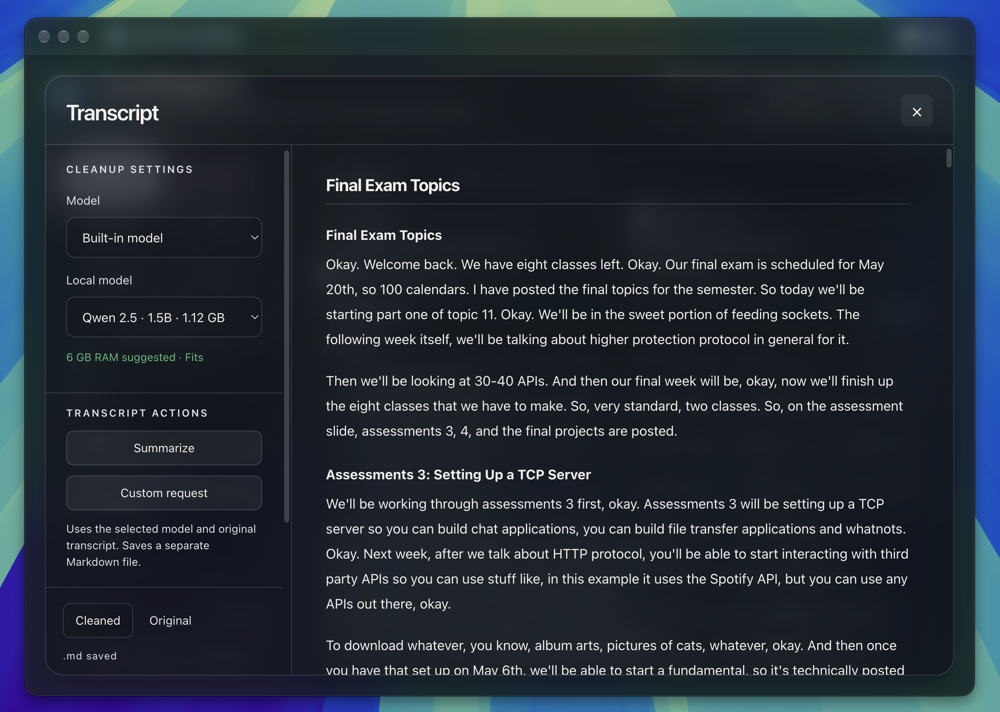
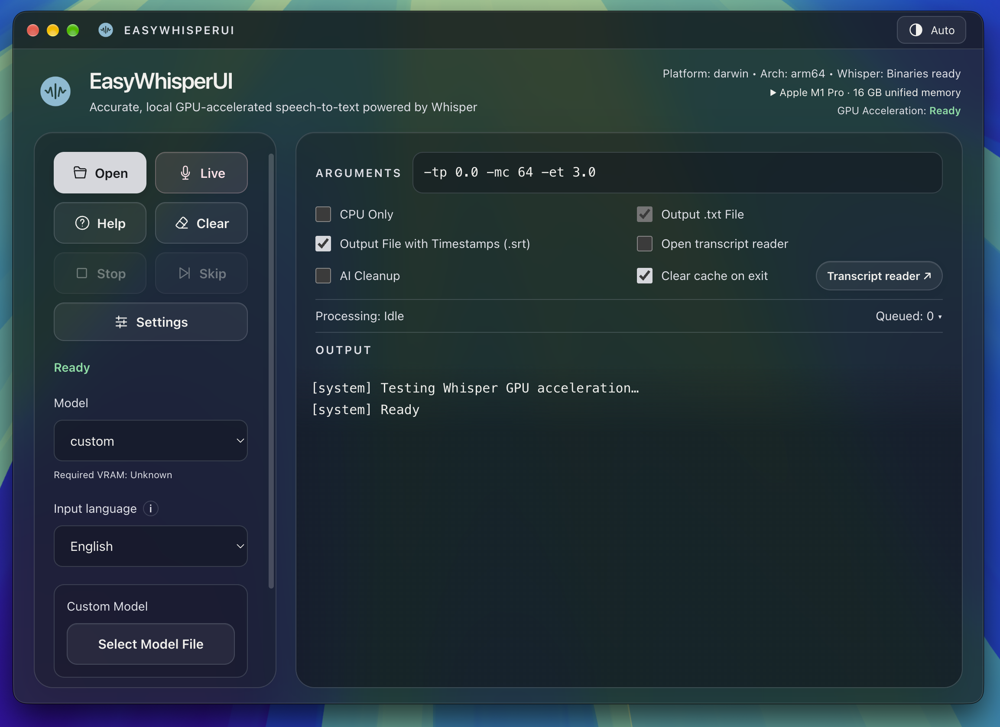

# EasyWhisperUI


**Local transcription, powered by your hardware.**

EasyWhisperUI brings local Whisper transcription, a real-time **Transcript Reader**, and **Local AI Summaries** together in one desktop app. Follow recordings as they transcribe, clean up the text, and create structured summaries or custom responses without leaving the reader. Local processing works offline after downloading the required tools and models.

[](https://www.paypal.com/donate/?business=5FM6Y27A3CK58&no_recurring=0&currency_code=USD)

**What should I work on next?** [Vote for the features you want most.](https://strawpoll.com/40Zm4PX02ga)

## Download

| Platform | Requirements | Download |
| --- | --- | --- |
| Windows | Windows 10/11, x64 | [3.2.0 installer](https://github.com/mehtabmahir/easy-whisper-ui/releases/download/v3.2.1/EasyWhisperUI-Setup-3.2.0-win-x64.exe) |
| macOS | macOS 13+, Apple Silicon | [3.2.1 DMG](https://github.com/mehtabmahir/easy-whisper-ui/releases/download/v3.2.1/EasyWhisperUI-3.2.1-macOS-arm64.dmg) |
| Linux | Beta; tested on Ubuntu | 3.2 pending; [previous releases](https://github.com/mehtabmahir/easy-whisper-ui/releases) |

Windows uses Vulkan on supported GPUs; macOS uses Metal. CPU-only processing is also available.

[Release notes](https://github.com/mehtabmahir/easy-whisper-ui/releases/tag/v3.2.1)

<table>
  <tr>
    <th width="50%">Transcript Reader</th>
    <th width="50%">Main Window</th>
  </tr>
  <tr>
    <td><a href="resources/preview-transcript-reader.png"></a></td>
    <td><a href="resources/preview-main-window.png"></a></td>
  </tr>
</table>

## New in 3.2

### A new Transcript Reader

Watch file transcriptions appear as Whisper processes your recording, or use **Live** to follow microphone speech in real time. A spacious reading area, Markdown support, and topic navigation make longer transcripts easier to read. Live transcription also merges overlapping phrases to reduce repetition.

### Local AI Summaries!

Turn lectures, interviews, and meetings into structured summaries without leaving the app. Choose **Clean up** to organize your transcript, **Summarize** for the key points, or **Custom request** for your own instructions. Results save as separate Markdown files, keeping the original transcript intact.

Run locally with built-in **Qwen 2.5 models from 3B to 14B**, load your own GGUF model, or connect an OpenAI-compatible API provider. Local models work offline after downloading.

### More improvements

- **Unified model management** — manage Whisper and AI models together in Settings.
- **Queue and retries** — view queued files, remove waiting items, and retry failed transcriptions.
- **Audio cache controls** — check storage use, open the cache folder, and choose whether to clear it on exit.
- **In-app updates** — check for new releases, download the installer, and close the app automatically when it opens.

## Features

- **Private, local transcription** — turn audio and video into text on your own computer.
- **GPU acceleration** — Vulkan on Windows and Metal on Apple Silicon, with automatic verification and a CPU-only option.
- **Languages and subtitles** — multilingual transcription, translation into English, and TXT/SRT exports.
- **Batch processing** — drag in multiple files, inspect the queue, remove waiting files, and retry failed transcriptions.
- **Live transcription** — read microphone speech as it arrives, with overlapping phrases merged and merged/raw text saved.
- **Model choice** — download, manage, or load custom models, with color-coded memory estimates.
- **Clear download progress** — see size, speed and time remaining, and cancel downloads when needed.
- **Light, Dark and Auto themes** — translucent backgrounds and a spacious output console.
- **Faster retries** — cached audio avoids repeated conversion when retrying or changing models.
- **Simple setup and repair** — guided installation and clean reinstall on Windows/Linux, preserving models and settings.
- **Advanced controls** — extra Whisper arguments, built-in CLI help, and accessible setup logs.

## Installation

1. Run the Windows installer, or open the Mac DMG and drag **EasyWhisperUI** into **Applications**.
2. Launch the app and let initial setup finish. macOS includes Whisper and FFmpeg.
3. Choose your model, input language, and output formats. Use a multilingual model for non-English audio; `.en` models are English-only. Missing models download automatically. For a local model, choose **custom → Select Model File**.
4. Enable **Open transcript reader**, then click **Open** or drop files into the window. Follow the text as it arrives; exports are saved beside the original files.
5. After transcription, use **Clean up**, **Summarize**, or **Custom request** in the reader. Choose **AI Cleanup** before starting a file to run cleanup automatically afterward.

To translate into English, choose a multilingual model such as `medium`, select the source language, and add `--translate` in **Arguments**.

## Requirements

- **macOS:** Apple Silicon, macOS 13 or newer. Whisper, Metal support and FFmpeg are bundled.
- **Windows:** Windows 10/11 x64. Initial setup downloads dependencies and builds Whisper. Current Vulkan-capable graphics drivers enable GPU acceleration; native Acrylic blur requires Windows 11 22H2 or newer.
- **Local AI:** suggested system memory is 8 GB for 3B, 12 GB for 7B, and 16 GB for 14B. Estimates vary with other apps and GPU memory; download size is not runtime memory use. The reader and ordinary transcription do not require a language model.
- **Linux:** support remains beta; 3.2 installers and in-app updates are pending.

## App updates

Windows and macOS builds with the updater check for newer stable GitHub releases after launch. You can also use **Settings → Maintenance → Check for updates**. Choose **Update** to download and verify the installer. The app waits for active work, opens the installer, then quits. On macOS, drag the updated app into Applications. Older public builds without the updater need a manual upgrade first.

See the [v3.2.0 release notes](https://github.com/mehtabmahir/easy-whisper-ui/releases/tag/v3.2.1#issues-addressed) for the full list of addressed issues and remaining limitations.

## Troubleshooting

On Windows/Linux, try **Settings → Clean reinstall**. On Mac, restart the app. If the problem continues, use **Settings → Maintenance → View logs** and [open an issue](https://github.com/mehtabmahir/easy-whisper-ui/issues/new) with the error, log, OS, CPU, GPU, RAM, app version, and model. If no setup log exists, copy the console error.

The Mac app is ad-hoc signed and not notarized. If macOS blocks it, try **System Settings → Privacy & Security → Open Anyway**. For a “damaged” message, follow the [release's first-opening instructions](https://github.com/mehtabmahir/easy-whisper-ui/releases/tag/v3.2.1#macos-first-opening).

## Development

Requires Node.js 22.12+; Node.js 24 is recommended. Mac builds also require Homebrew and Xcode Command Line Tools. Clone with submodules, then:

```bash
cd electron
npm install
npm run dev
```

Use `npm run dist` to package the app into `build/electron-dist` at the repository root. See the [developer README](electron/README.md) for architecture and platform setup.

## Support

I'm a solo developer, and countless hours went into refining EasyWhisperUI. **Donations are the project's only source of funding.** If you find it useful, please consider supporting continued development.

[](https://www.paypal.com/donate/?business=5FM6Y27A3CK58&no_recurring=0&currency_code=USD)

Thank you to my supporters:

- Craig H — $50
- Eric De Vet — $10
- Jan P — $5
- Minh P — $5
- Rödvarg R — $2

## Credits

Special thanks to past contributors, such as [celerycoloured](https://github.com/celerycoloured) who authored the initial macOS release back when it was C++, and to everyone who has supported the project through donations, bug reports, and feature requests. Your contributions helped make EasyWhisperUI better.

[whisper.cpp](https://github.com/ggerganov/whisper.cpp) by Georgi Gerganov · [FFmpeg](https://ffmpeg.org) · [Windows FFmpeg builds](https://github.com/BtbN/FFmpeg-Builds) · [macOS FFmpeg builds](https://ffmpeg.martin-riedl.de/) · [SDL2](https://www.libsdl.org/) · [electron-builder](https://www.electron.build/)

## License

```text
Copyright (c) 2026 Mehtab Mahir
All rights reserved.

This software is proprietary and the following is not allowed for commercial purposes:
it may not be copied, modified, distributed, or used without explicit permission from the author.

Those actions are permitted for personal use ONLY.

This application includes the following open-source components:

---

whisper.cpp by Georgi Gerganov
License: MIT
[https://github.com/ggerganov/whisper.cpp](https://github.com/ggerganov/whisper.cpp)

---

FFmpeg
License: depends on the build; the bundled macOS binary is GPL 3.0 or later.
Windows setup downloads a GPL build from BtbN.
[https://ffmpeg.org](https://ffmpeg.org)
Windows builds: https://github.com/BtbN/FFmpeg-Builds
macOS builds: https://ffmpeg.martin-riedl.de/

The FFmpeg binary is provided as a separate file and may be replaced with a compatible version.

---

SDL2 (bundled on macOS)
License: zlib
https://www.libsdl.org/
```
